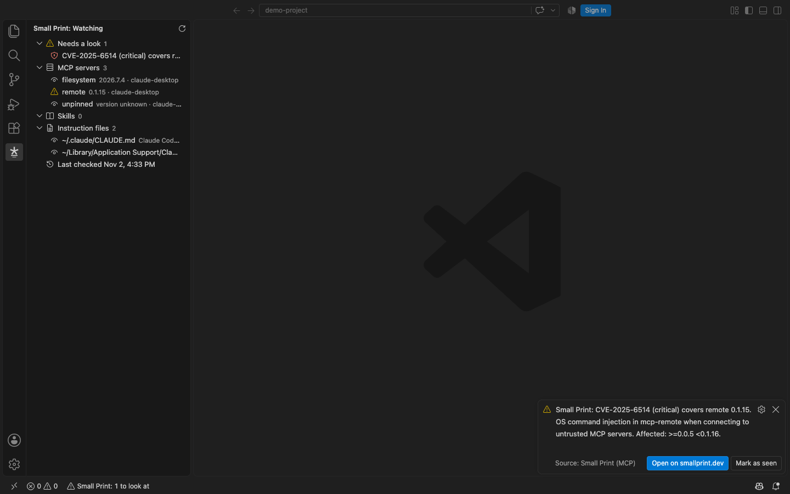

# Small Print (MCP) for VS Code and Cursor

Your AI agent follows the text that its MCP servers, skills and instruction files give it: tool descriptions, skill instructions, `CLAUDE.md`, `AGENTS.md`, rules. That text can change between versions without the version number saying so. This extension watches it for you.

## What it watches

- **Instruction files** such as `CLAUDE.md`, `AGENTS.md`, `.mcp.json` and Cursor and Windsurf rules. When one changes outside this editor, you get a notice and a side-by-side view of what changed. This runs entirely on your machine.
- **Skills** that your agents load. When a skill's files change on disk, you get a notice. This also runs entirely on your machine.
- **MCP servers** that come from a published package. Once you allow it, the extension looks each one up on the public record at [smallprint.dev](https://smallprint.dev). By default you get a notice when a change on record is graded high or critical, and when a high or critical security advisory's range covers, or may cover, the version you run.

Everything it finds is listed in the Small Print panel, and the status bar shows when something needs a look.

## What leaves your machine

Nothing, until you allow the lookup. After that, one request per MCP server that has a package name, asking the record about that package: the package name is the only thing sent. No versions, no config values, no environment variables, no keys, no file paths and no file contents ever leave your machine. Run **Small Print: Show what would be sent** to see the exact requests. Set `smallprint.lookup` to `never` to keep every watch on your machine.

## Settings

The lookup setting and the record's address are read only from your user settings. A repository's settings cannot turn the lookup on or send it anywhere else, and the address must use https.

- `smallprint.lookup`: `ask` (the default), `allow` or `never`.
- `smallprint.notify`: `high` (the default) pops a notice for changed instruction files and skills, advisories, and changes graded high or critical; `any` for every graded change; `none` to only list them in the panel.
- `smallprint.checkEveryHours`: how often to check the record, 6 by default.

## What it does not do

It does not watch what a server does while it runs, it does not sit between your agent and its tools, and it cannot stop a tool call.

The extension is open source under the MIT licence. It is made by EmberStack LLC, which runs [smallprint.dev](https://smallprint.dev).

## Screenshots

On first start it asks before anything is sent:

A critical advisory's range covers the version of a server this machine runs:

An instruction file changed outside the editor:

